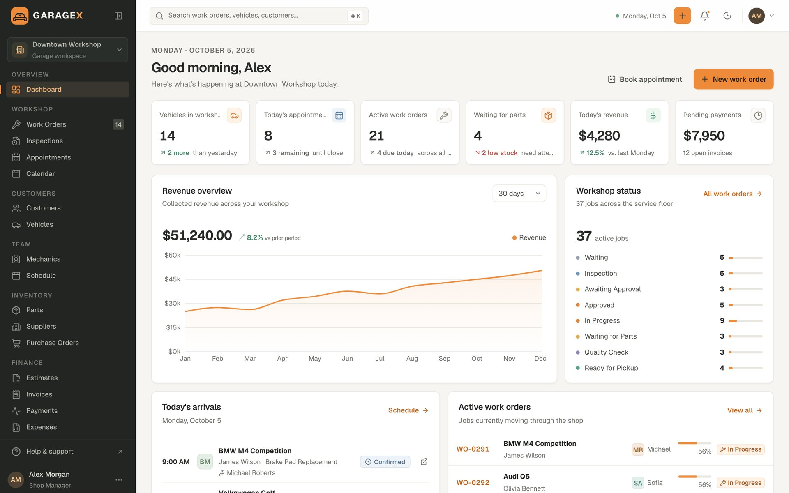

# GarageX Lite — free Next.js auto repair & workshop dashboard

**Every vehicle. Every detail. Under control.** A free, open-source admin dashboard for auto repair shops and workshops, built with Next.js 16, React 19, TypeScript and Tailwind CSS v4.

**[Live demo of the full version →](https://garagex-psi.vercel.app)** · **[Get GarageX Pro →](https://beaj5.gumroad.com/l/garagex)**



## What's in Lite

- **Workshop dashboard:** KPIs, revenue overview chart, workshop status, today's arrivals, active work orders, bay occupancy, technician workload, inventory alerts and recent activity
- **Customer directory:** TanStack Table with search, status filter, sorting, column visibility, pagination, CSV export and an add-customer dialog
- **App shell:** collapsible sidebar, mobile navigation drawer, command search (⌘/Ctrl K), location switcher, notifications, light/dark/system theme, toasts, loading skeletons and a 404 page
- **Sign-in, forgot-password and reset-password screens**, plus typed, connected demo data

## Lite vs Pro

|                                                                         | Lite (free) | [Pro](https://beaj5.gumroad.com/l/garagex) |
| ----------------------------------------------------------------------- | :---------: | :----------------------------------------: |
| Dashboard, customer directory, app shell, auth screens                  |      ✓      |                   ✓                   |
| Drag-and-drop work order board, check-in wizard, repair order workspace |             |                   ✓                   |
| Digital vehicle inspections with condition map                          |             |                   ✓                   |
| Day / week / month workshop calendar                                    |             |                   ✓                   |
| Customer, vehicle and technician profiles                               |             |                   ✓                   |
| Parts inventory, suppliers, purchase orders, services catalog           |             |                   ✓                   |
| Estimates with approvals, print-ready invoices, payments, expenses      |             |                   ✓                   |
| Business reports, messages inbox, notifications, documents              |             |                   ✓                   |
| Settings (business, locations, roles, opening hours, tax…)              |             |                   ✓                   |
| HTML documentation and support                                          |             |                   ✓                   |
| License                                                                 |     MIT     |              Commercial               |

Pro screens appear in Lite's sidebar with a **PRO** badge and open a preview that links to the same screen in the live demo.

## Getting started

Requires Node.js 22.13+.

```bash
npm install
npm run dev
```

Open http://localhost:3000. The root redirects to `/dashboard`.

```bash
npm run build      # production build
npm run lint       # ESLint
npm run typecheck  # TypeScript
npm test           # demo-data tests
```

## Tech stack

Next.js 16 (App Router) · React 19 · TypeScript (strict) · Tailwind CSS v4 · Radix UI · Recharts · TanStack Table · Zod · date-fns · next-themes · Sonner · Lucide icons · Geist font

## Customizing

- **Colors:** CSS custom properties at the top of `src/app/globals.css` (`:root` for light, `.dark` for dark)
- **Logo:** `BrandMark` in `src/components/ui/primitives.tsx` and `src/app/icon.svg`
- **Navigation:** the `nav` array in `src/components/shell/app-shell.tsx`
- **Demo data:** typed records in `src/data/demo.ts`
- **Backend:** replace the seed data and reducer actions in `src/hooks/use-garage.tsx` with your API

This is a frontend template with fictional data. It has no backend or real authentication.

## License

MIT. See `LICENSE`. Third-party packages keep their own licenses; see `THIRD_PARTY_NOTICES.md`.
